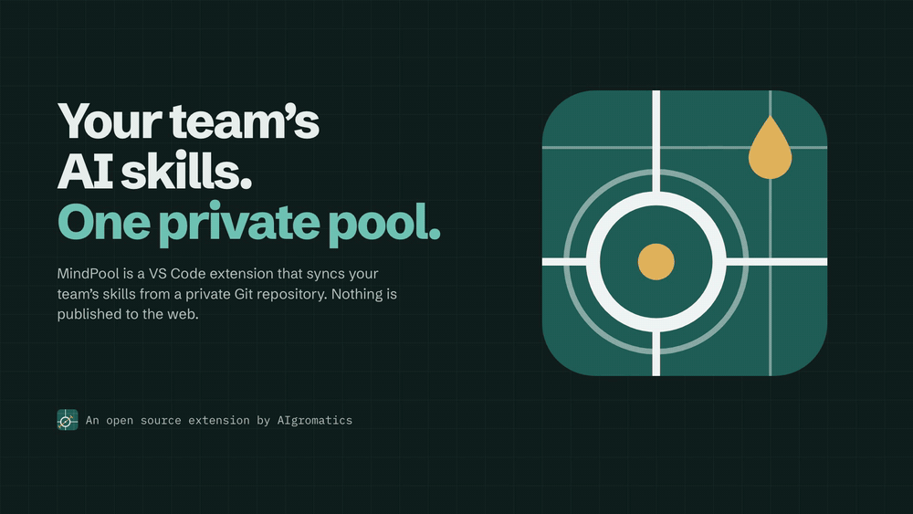
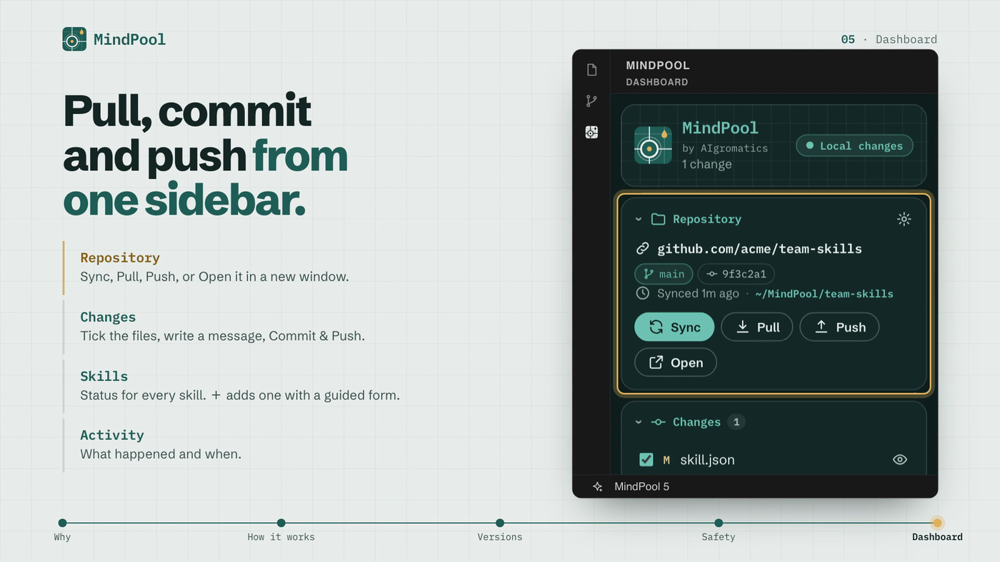

# MindPool

[](https://marketplace.visualstudio.com/items?itemName=aigromatics.mindpool)
[](https://marketplace.visualstudio.com/items?itemName=aigromatics.mindpool)
[](https://github.com/AiGromatics/MindPool)
[](LICENSE)

**A `package.json` for your team's AI skills.** List them in a `skill.json`, keep it in a private
Git repository, and MindPool keeps every teammate's skills installed, versioned and in sync.
Nothing is published to the web.



## Why MindPool

- **Every teammate has a different copy.** Skills get edited, forgotten and left behind.
  MindPool installs the same versions on every machine and keeps them up to date.
- **Private by design.** Skills live in your own Git repository and travel with your normal Git
  credentials. Nothing goes to a public registry.
- **Versioned like npm.** Track a branch, pin a release tag, or follow a semver range such as
  `^1.2.0` that upgrades by itself.
- **Local edits are safe.** A skill you changed by hand is never overwritten. You decide when to
  reinstall it.

Works with **Claude Code** out of the box: set [`mindpool.linkSkillsTo`](#skill-links) to
`~/.claude/skills` and every team skill shows up there. Any other tool that reads skill folders
works the same way.

## How it works

- Point MindPool at a **pool folder** and your **team skills repository**. Both are ordinary
  VS Code settings, and the dashboard fills them in for you.
- It clones the repository into the pool folder and keeps it in sync, pulling new commits
  automatically.
- The repository's `skill.json` lists the skills, like `dependencies` in a `package.json`. Every
  skill is downloaded via git into **`mindSkills/`**, a folder that is never committed. Only the
  team settings get pushed.
- On every sync, MindPool checks for **newer skill versions** and installs them.
- **Pull**, **commit** and **push** right from the dashboard. For anything more complicated, one
  click **opens the repository in a new VS Code window**.

## Quick start

1. Install MindPool from the
   [Visual Studio Marketplace](https://marketplace.visualstudio.com/items?itemName=aigromatics.mindpool),
   or run `code --install-extension aigromatics.mindpool`.
2. Open the **MindPool** icon in the activity bar.
3. Click **Choose pool folder** (any folder, for example `~/MindPool`).
4. Fill in the repository URL and branch, optionally a release tag, then **Save & clone**.

That's it. MindPool saves your answers in the VS Code settings, clones the repository and
installs the skills.

```
~/MindPool/                  ← pool folder (setting: mindpool.poolFolder)
└── team-skills/             ← the cloned team repository (Git, setting: mindpool.repository)
    ├── skill.json           ← the skills the team shares (committed)
    └── mindSkills/          ← downloaded skills (git-excluded, never pushed)
        ├── code-review/
        └── pdf-tools/
```

## Repository settings

The dashboard form (⚙ on the **Repository** card) writes these settings for you. You can also
change them in **Settings → Extensions → MindPool** (*MindPool: Open Settings*), or in
`settings.json`:

```json
{
    "mindpool.poolFolder": "~/MindPool",
    "mindpool.repository": "git@github.com:acme/team-skills.git",
    "mindpool.branch": "main",
    "mindpool.tag": "v1.4.0",
    "mindpool.directory": "team-skills",
    "mindpool.linkSkillsTo": ["~/.claude/skills"]
}
```


| Setting                 | Default | Meaning                                                                                                           |
| ----------------------- | ------- | ----------------------------------------------------------------------------------------------------------------- |
| `mindpool.poolFolder`   | `""`    | Folder where the team repository is cloned. Supports `~`, `${userHome}`, `${workspaceFolder}`.                    |
| `mindpool.repository`   | `""`    | Git URL of the team repository (https, ssh or a local path). Required.                                            |
| `mindpool.branch`       | `main`  | Branch to track. New commits are fast-forwarded automatically. Required, even with a tag.                         |
| `mindpool.tag`          | `""`    | Release tag to pin. The checkout becomes **read-only**, and newer releases are offered with a one-click upgrade. |
| `mindpool.directory`    | `""`    | Folder name for the clone, inside the pool folder. Defaults to the repository name.                               |
| `mindpool.linkSkillsTo` | `[]`    | Folders where every installed skill gets a link. See [Skill links](#skill-links).                                 |

A change takes effect right away: MindPool syncs again (or only refreshes, when
`mindpool.autoSync` is off). User settings apply in every window. A workspace can override them in
its `.vscode/settings.json`, for example to follow another release in one project, and the
dashboard then saves your edits to the workspace settings.

> **Upgrading from 1.0?** MindPool no longer reads `config.json`. Fill in the dashboard form
> once with the same values (or copy them into the settings above). The clone already in the pool
> folder is reused.

### Skill links

Some AI tools only find skills one level deep. Claude Code, for example, reads
`~/.claude/skills/<name>/SKILL.md`, so it never sees `team-skills/mindSkills/<name>/`. Set
`mindpool.linkSkillsTo` and MindPool keeps one link per skill in that folder: a symlink, or a
junction on Windows.

- A skill with a `SKILL.md` at its root is linked under its `skill.json` name. A repository that
  holds several skills, in `skills/<name>/` (like superpowers) or in `<name>/`, gets one link
  per skill.
- `~` and `${userHome}` work. A relative path starts at the pool folder, so `"."` links the
  skills into the pool folder itself, which is handy when the pool folder is `~/.claude/skills`.
- Links follow `skill.json`: they're added, repointed and removed on every sync, and emptying
  `mindpool.linkSkillsTo` removes them.
- MindPool only touches links that point into `mindSkills/`. A real folder, or someone else's
  link, with the same name is left alone and reported in the **Skills** card.
- Folders inside the team repository are refused, because the links would show up as changes.

## `skill.json`

```json
{
    "name": "acme-team-skills",
    "skills": {
        "code-review": "https://github.com/acme/skill-code-review.git",
        "pdf-tools":   "https://github.com/acme/pdf-tools.git#^2.1.0",
        "writer":      { "repository": "git@github.com:acme/writer.git", "branch": "develop" },
        "planner":     { "repository": "https://github.com/acme/planner.git", "tag": "v1.4.0" },
        "translator":  { "repository": "https://github.com/acme/translator.git", "version": "~1.2" }
    }
}
```


| Source                       | Installs                               | On each sync                                               |
| ---------------------------- | -------------------------------------- | ---------------------------------------------------------- |
| `"url"`                      | newest commit of the default branch    | updates to new commits                                     |
| `{ "branch": "develop" }`    | newest commit of that branch           | updates to new commits                                     |
| `{ "tag": "v1.4.0" }`        | exactly that tag                       | stays pinned and**reports** newer releases                 |
| `{ "version": "^1.2.0" }`    | highest tag matching the semver range  | **upgrades inside the range**, reports versions outside it |
| `"url#ref"` / `"url#^1.2.0"` | shorthand: a tag or branch, or a range | as above                                                   |

Ranges work like npm's: `^1.2.0`, `~1.2`, `>=2 <3`, `1.x`, `1.0.0 - 2.0.0` and `^1 || ^2`. A
leading `v` in tags is fine.

Safety rules:

- A skill with **local modifications** is never overwritten. It shows as *local changes*, and you
  decide whether to **Reinstall**.
- Skills removed from `skill.json` are pruned from `mindSkills/`. That only happens when the file
  is valid, and never when the folder has local changes.

## The dashboard




| Card           | What you can do                                                                                                                                                                                                                            |
| -------------- | ------------------------------------------------------------------------------------------------------------------------------------------------------------------------------------------------------------------------------------------ |
| **Repository** | See branch or tag, HEAD, how many commits to push and pull, and last sync. Use**Sync**, **Pull** (rebase), **Push** and **Open** (new window). Adjust settings with ⚙.                                                                    |
| **Changes**    | Tick the files to include, write a message, then**Commit** or **Commit & Push** (⌘/Ctrl+Enter).                                                                                                                                           |
| **Skills**     | Shows status per skill (up to date, update ready, local changes, error) and newer versions. Install, reinstall, reveal or remove a skill.**＋** adds one with a guided form that checks the repository and suggests its branches and tags. |
| **Activity**   | Shows what happened and when. The full git output is in the*MindPool* output channel.                                                                                                                                                      |

The status bar shows the pool's health at a glance. Click it to open the dashboard.

## Commands

`MindPool: Sync Now` · `Select Pool Folder…` · `Pull` · `Commit Changes…` · `Push` ·
`Open Repository in New Window` · `Open Settings` · `Open skill.json` · `Add Skill…` ·
`Update All Skills` · `Reveal mindSkills Folder`

## Settings

The repository settings are described [above](#repository-settings). The others control syncing:


| Setting                        | Default |                                                                                    |
| ------------------------------ | ------- | ---------------------------------------------------------------------------------- |
| `mindpool.autoSync`            | `true`  | Sync on startup, on a timer and when the MindPool settings or `skill.json` change. |
| `mindpool.syncIntervalMinutes` | `15`    | `0` disables the timer.                                                            |
| `mindpool.autoUpdateSkills`    | `true`  | When off, updates are only reported.                                               |
| `mindpool.gitPath`             | `git`   | Git executable.                                                                    |

MindPool uses your normal Git credentials (credential helper or SSH agent). It never prompts in
the background. If authentication is needed, use **Open** and sign in through VS Code's Git.

## Development

Everything is TypeScript, and every import points to a `.ts` file. Node ≥ 22.18 runs the sources
directly: no transpile step for tests or scripts.

```bash
npm install
npm run typecheck   # tsc --noEmit
npm test            # unit + git integration tests (node --test, real git repositories)
npm run test:e2e    # downloads VS Code and runs the extension end to end
npm run build       # → dist/main.cjs (single monolithic bundle)
npm run package     # → mindpool-<version>.vsix
```

Press **F5** to launch an Extension Development Host.

### Commit messages and releases

Commit messages follow [Conventional Commits](https://www.conventionalcommits.org). The release
script reads them to choose the next version:

| Commit                                        | Release |
|-----------------------------------------------|---------|
| `feat: …`                                     | minor   |
| `fix: …`, `perf: …`, `revert: …`              | patch   |
| `feat!: …` or a `BREAKING CHANGE:` footer     | major   |
| `docs:`, `test:`, `ci:`, `chore:`, `build:`, `style:`, `refactor:` | none |
| any other message                             | patch if it changes shipped files (`src/` except tests, `media/`, `schemas/`, `package.json`), otherwise none |

```bash
npm run bump:check   # is a release needed, and which version? (changes nothing)
npm run bump         # update package.json, package-lock.json and CHANGELOG.md, commit and tag vX.Y.Z
git push --follow-tags   # the vX.Y.Z tag starts the Publish workflow
```

- A release is only made when something users get has changed. Docs and test commits on their
  own never trigger one.
- If you set the version in `package.json` by hand, that exact version is released.
- `npm run bump -- --release-as minor` (or `2.0.0`) overrides the automatic choice.
- `--no-git` only writes the files, and `--json` prints the result for CI.
- The script refuses to release from a dirty working tree, a detached HEAD or a branch that is
  behind its upstream. It never pushes.

#### Publishing

Every release goes to both registries. Cursor, Windsurf and VSCodium install extensions from
[Open VSX](https://open-vsx.org), not from the Visual Studio Marketplace.

GitHub Actions does it: [`.github/workflows/publish.yml`](.github/workflows/publish.yml) runs
when a `vX.Y.Z` tag is pushed. It checks that the tag matches `package.json`, runs the unit
tests, packages the extension once (type check + build) and publishes that same `.vsix`:

- **Visual Studio Marketplace** with
  [Trusted Publishing](https://code.visualstudio.com/api/working-with-extensions/publishing-extension):
  GitHub's OIDC token is exchanged for a 15-minute credential, so no token is stored anywhere. The
  `AiGromaticsPipeline` policy of the `aigromatics` publisher trusts repository
  `AiGromatics/MindPool`, workflow `publish.yml`, no environment. Renaming the workflow, or adding
  an `environment:`, needs the same change in the policy.
- **Open VSX** with the `OVSX_PAT` repository secret (*Settings → Secrets and variables →
  Actions*). Without the secret this step is skipped.

To publish without a new tag, for example after fixing a failed run, start the workflow by hand
(*Actions → Publish → Run workflow*, or `gh workflow run publish.yml --ref main`). It publishes
the version in `package.json` of that branch. A version that is already published is skipped, so
re-running is safe. The `.vsix` of every run is kept as the `mindpool-vsix` artifact.

From your own machine, `npm run publish:marketplace` (token in `VSCE_PAT`) and
`npm run publish:ovsx` (token in `OVSX_PAT`) still work. Azure DevOps retires the global tokens
the Marketplace needs on December 1, 2026, so prefer the workflow.

The first Open VSX release needs an [open-vsx.org](https://open-vsx.org) account (signed in with
GitHub), the signed Publisher Agreement, an access token, and the namespace:
`npx ovsx create-namespace aigromatics -p <token>`.

### Architecture: one monolith

`scripts/build.ts` bundles everything into **one file, `dist/main.cjs`**. The webview client is
compiled for the browser and inlined into the extension bundle. There are no runtime
dependencies, only `vscode` and Node built-ins (semver is implemented in-house).

```
src/
├── main.ts                      entry point (activate / deactivate)
└── VsCodeExtension/
    ├── extension.ts             wiring
    ├── controller.ts            VS Code glue: settings, commands, watchers, timer, messages
    ├── core/                    pure Node logic, fully unit-tested, no vscode import
    │   ├── engine.ts            sync orchestration and the serialised operation queue
    │   ├── poolRepository.ts    clone / fetch / fast-forward / pull / commit / push / tags
    │   ├── skillManager.ts      resolve versions (ls-remote) and shallow installs into mindSkills
    │   ├── links.ts             linkSkillsTo: one link per skill (e.g. in ~/.claude/skills)
    │   ├── config.ts            repository settings: validation and change detection
    │   ├── manifest.ts          skill.json
    │   ├── semver.ts            npm-style ranges
    │   ├── git.ts               git runner and output parsers
    │   └── validation.ts        names, URLs, refs, paths (untrusted input)
    └── ui/
        ├── render.ts            pure HTML rendering (shared by webview and tests)
        ├── client.ts            webview script (browser)
        ├── styles.ts, icons.ts  theme-aware CSS and a hand-drawn SVG icon set
        ├── dashboardProvider.ts, statusBar.ts, html.ts, messages.ts, status.ts
```

## License

GPL-3.0. See [LICENSE](LICENSE).

The dashboard uses the AIgromatics brand fonts, Schibsted Grotesk and IBM Plex Mono, under the
SIL Open Font License 1.1. `scripts/build.ts` inlines them into the bundle; their licenses are in
[`media/fonts/`](media/fonts).
